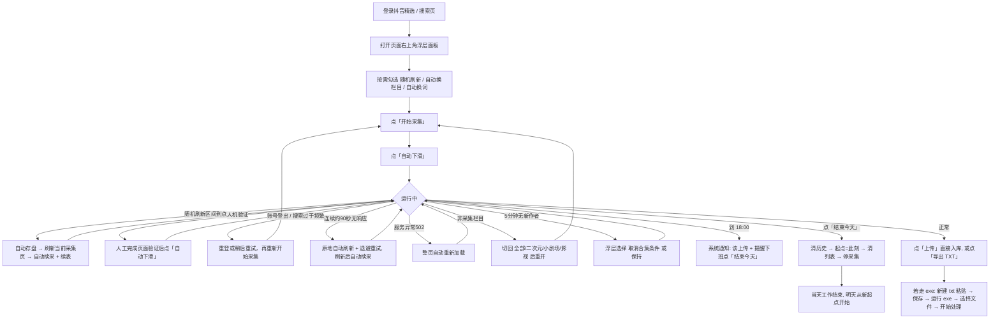

# 抖音 AI 合集作者采集 — 使用流程 SOP

| 项目 | 内容 |
|---|---|
| 文档版本 | v1.3.8（正式版） |
| 适用版本 | 扩展 v1.3.8（正式版） |
| 更新日期 | 2026-10-28 |
| 适用范围 | 采集团队全体成员 |
| 关联工具 | 扩展内置「上传」按钮 · `douyin_sec_id_upload_tool.exe` · 监控后台 `dyaccount_1.1.2plus.html` |

---

## 1. 目的

规范「抖音 AI 合集作者」的采集、导出与上传流程，确保操作一致、数据准确、账号安全。

采集目标：收集满足以下条件的作者唯一标识 `sec_uid`。

1. 视频**挂载了合集**
2. 视频带有作者声明：**内容由 AI 生成**
3. **内容类型命中白名单、且不撞黑名单**（合集名或昵称归一化后判断）

> 前两条是采集时的拦截条件，面板里有勾选框，可取消以放宽；**内容类型没有开关**，采集时不做拦截、导出为全量，类型达标与否由监控后台分级复核判定。搜索词生成时仍必须锚定白名单词、避开黑名单词，否则捞回来的作者在后台复核里大概率判无效。

---

## 2. 适用范围

- 采集页面：抖音**精选**（`www.douyin.com/jingxuan`）、**搜索**（`www.douyin.com/search/…`）、**播放页**，以及 **4 个采集栏目页**（全部 / 二次元 / 小剧场 / 影视）。
- 浏览器：Chrome 或 Edge（均在开发者模式下加载未打包扩展）。
- 数据流向：浏览器本地采集 → 面板/弹窗直接上传，或导出 TXT 后用 exe 上传。

---

## 3. 前置条件

- [ ] 已安装 Chrome 或 Edge 浏览器。
- [ ] 拥有抖音账号，且能在目标电脑上正常登录。
- [ ] 拿到扩展源码目录（包含 `manifest.json` 的文件夹）。
- [ ] 若走 exe 上传路线，拿到 `douyin_sec_id_upload_tool.exe`。

---

## 4. 关键术语

| 术语 | 含义 |
|---|---|
| `sec_uid` | 抖音作者唯一标识，形如 `MS4wLjABAAAA…`，是最终要上传的数据 |
| 合集 | 视频挂载的「合集 / mix」入口，接口字段为 `mix_info` / `mixInfo` |
| AI 声明 | 文案「内容由 AI 生成」或接口 `aigc_info.aigc_label_type === 1` |
| 内容类型 | 合集名/昵称命中的 AI 内容类别（漫剧/短剧/AIGC/动画等） |
| 采集栏目 | **全部 / 二次元 / 小剧场 / 影视** 四个栏目属于采集范围 |
| 内嵌浮层面板 | 抖音页面右上角的小面板，功能与扩展弹窗（popup）一致，是主入口；弹窗留作备用 |
| 自动下滑 | 脚本模拟滚动加载更多内容 |
| 随机刷新 | 按随机区间定时刷新当前采集页，替代旧的「随机刷新控制器.exe」 |

---

## 5. 首次安装

1. 打开 Chrome，地址栏输入 `chrome://extensions/` 回车。Edge 为 `edge://extensions/`。
2. 打开页面右上角的 **开发者模式** 开关。
3. 点击 **加载已解压的扩展程序**。
4. 在弹出的文件选择框中，选中扩展源码目录（**包含 `manifest.json` 的那一层**），点确定。
5. 确认扩展列表中出现了「抖音 AI 合集作者采集 1.3.8」。
6. （可选）将插件图标固定到工具栏，方便点击。

> **更新扩展时只点「重新加载」**：在 `chrome://extensions` 点插件的 **重新加载** 按钮，再刷新抖音页面即可生效。
>
> **换装三步纪律**（同目录覆盖 vs 换目录，结果完全不同）：
> 1. **默认走同目录覆盖**：把新文件覆盖进原来那个目录，再点「重新加载」。`chrome.storage` 全部保住。
> 2. **非换目录不可时，先备份**：在面板点「导出 CSV」存一份；或在**完全退出 Chrome** 后整目录拷走 `%LOCALAPPDATA%\Google\Chrome\User Data\Default\Local Extension Settings\mgcnblpoikblnppolddcjgaocnnalcbk`。
> 3. **回灌后立刻校验四样**：① `chrome://extensions` 卡片版本号 ② 扩展 ID 仍是 `mgcnblpoikblnppolddcjgaocnnalcbk` ③ 面板「新增作者」累计数 ④ 当日起点时刻。
>
> **为什么不能「移除」再加载**：移除未打包扩展会**连带删除该扩展的 `chrome.storage`**（LevelDB 整份清空），哪怕 `key` 相同、扩展 ID 相同。起点、已采集列表、重置历史全丢。这不是扩展的 bug，是 Chrome 的行为。详见《项目交接说明.md》§3.1。
>
> **同版本号多包并存提醒**：v1.3.3 及以前内部有过几批修补，同一个版本号可能对应 **sha 不同**的包。接收/加载前先核对随包的 `dyaccount_v1.3.3-SHA256SUMS.txt`（以整包 sha256 为准）；在 `chrome://extensions` 确认卡片指向的目录是本机最新那一份。 <!-- ver-ok -->
>
> **自 v1.3.4 起：一版一链，以随包 `SHA256SUMS` 为准**。同一版本号下允许纯文档重出（只换 `bN` 标签），此时 `PREDECESSOR` 会指回上一包，**按链条核、不要按版本号猜**。扩展 ID 已由 `manifest.json` 里的 `key` 固定，**换目录、改文件夹名都不会再变 ID**；但**换目录必须走 §3.1 的三步纪律**（先备份再移除），否则 `chrome.storage` 会随「移除」一起丢。 <!-- ver-ok -->

---

## 6. 采集标准操作流程

以下为标准操作全流程总览（Mermaid 图，需用支持 Mermaid 的编辑器渲染，如 Typora / VS Code / GitHub）：

### 6.1 打开页面

1. 登录 [抖音精选](https://www.douyin.com/jingxuan)，或先进入搜索页、栏目页。
2. 确认页面已登录、能正常浏览内容。

### 6.2 配置采集参数

点击插件图标打开弹窗，或直接看页面右上角浮层面板（两者功能一致），按需设置：

| 参数 | 默认 | 说明 |
|---|---|---|
| 必须挂载合集 | 勾选 | 取消勾选可放宽采集条件 |
| 必须「内容由 AI 生成」 | 勾选 | 约等于必选，一般不取消 |
| 自动间隔 | 4 秒 | 可选 4 / 6 / 8 秒（建议保持 4 秒，防风控） |
| 随机刷新（仅采集页生效） | 关闭 | 见 6.3，替代旧的随机刷新 exe |
| 刷新区间 | 180 ~ 480 秒 | 输入框限 30~3600 秒；min>max 自动交换 |
| 自动换栏目 | 关闭 | 在采集栏目页生效，需要时手动打开 |
| 自动换搜索词 | 关闭 | 仅在搜索页生效，需要时手动打开 |
| 搜索页切「最新发布」 | 勾选 | 搜索页自动切到最新发布排序 |

### 6.3 启动采集

1. 点 **开始采集**。
2. 点 **自动下滑**（精选/搜索页持续滚动加载更多；播放页会自动切下一条）。
3. 若要随机刷新：勾选「随机刷新」后点 **开始计时**；勾了随机刷新时，点「开始采集」会自动起表。也可以点 **立即刷新一次** 手动刷一次。

随机刷新说明：

- 默认 **180~480 秒**随机一个时间点刷新，输入框限 **30~3600 秒**。
- 只对采集页生效（精选 / 搜索页 / 播放页 / 4 个栏目页）；不在这些页面则跳过本轮，并累计「跳过 N 次」。
- 刷新前先存盘，刷新后自动续采 + 继续计时。
- 面板实时显示：`运行中 · 下次刷新 xx 秒 · 已刷 N 次 · 跳过 N 次`。
- 页面故障自动处理期间会暂停随机刷新，处理完自动恢复。

### 6.4 运行中监控

在浮层面板观察：

- **本轮作者**：已命中并去重入库的作者数量。
- **已扫视频**：累计扫描过的视频数。
- **当日起点**：`当日起点 2026-10-27 09:27:09（今日 12 个）`。起点之后命中的作者才算「今日 N 个」。
  起点**不再有单独的重置按钮**（1.3.5 起移除）；点旁边的「**结束今天**」才是下班收工动作，见 6.6。
  - 显示 `当日起点 未连接` = 取数失败（后台没响应/存储没读到），**不是**起点真的在 0 点。
    此时「今日」的筛选边界按**本地零点**兜底计算，N 会偏大；重开面板或点「开始采集」通常即可连上。
  - 跨天不用人工设起点：自动回落到**今天第一个作者的采集时间**（`firstSeen`）；
    只有今天一条都没采到，才显示 `00:00:00`。（「未连接」只表示取数失败，与 0 点无关。）
- **上一次重置**：起点行下面那行，`上一次重置：2026-10-27 12:40:34（共 8 个）`，
  括号里的 N = 那次重置前「今日 N 个」的数，可用来核对这次收工交出去多少。
- **重置历史**：点 `▸` 展开，形如 `12:40:34 · 共 8 个 · 结束今天`。
  **最多 5 条、只留当天**，跨天后自动只剩当天（读取时按日期过滤，不靠定时任务）。
  上传触发的自动重置**不写历史**，所以正常情况下一天里只会出现「结束今天」这一种。
- 命中时面板会闪红提示「新命中 N 位作者」。

### 6.5 自动暂停 / 自动刷新场景与处理

脚本遇到以下情况会**自动停 / 自动刷新**，需人工介入的部分会给出非阻塞提示：

| 场景 | 面板/通知表现 | 处理动作 |
|---|---|---|
| 人机验证 | 面板提示 + 系统通知「检测到人机验证」 | 人工完成页面验证，再点「自动下滑」恢复 |
| 账号被登出 | 面板提示 + 通知「账号已登出」 | 重新登录后先手动浏览几分钟，再重新开始采集 |
| 搜索过于频繁 | 面板提示 + 通知「搜索被限流」 | 稍等一段时间后重试 |
| 非采集栏目 | 面板提示 + 通知「非采集栏目」 | 切回「全部 / 二次元 / 小剧场 / 影视」后重新开始 |
| 连续无响应（约 90 秒无数据） | 提示「连续无响应，xx 秒后自动刷新」 | 脚本按 30 秒 / 60 秒 / 2 分 / 5 分退避自动刷新并续采；用尽仍无响应才停下转人工 |
| 服务异常 502（整页打不开） | 通知「平台抖动，任务已暂停」 | 脚本按退避序列整页自动重新加载 |
| 连续 5 分钟无新作者 | 面板浮出「取消合集条件 / 保持」选择框 | 按需选择是否放宽合集条件 |
| 每天 18:00（仅一条） | 系统通知「今天累计采集 N 个作者…下班前记得点「结束今天」」 | 到点上传；下班点「结束今天」。**18:10 那条已删除，不会再响** |

> 以上提示均为**页面浮层 + 浏览器系统通知**，不会弹阻断式窗口，后台挂机也不会假死。

### 6.6 停止采集 / 下班「结束今天」

**只是暂停**（还要接着采）：点 **停止采集**。数据自动留在本地，可直接导出或上传，起点不动。

**当天收工**（推荐，一次清干净）：点 **结束今天**，确认框写的是
`将同时：① 清空重置历史 ② 起点重置为此刻 ③ 清空已采集列表 ④ 停止采集。（已上传的数据不受影响）`

确认后一次做四步（顺序固定）：

1. 清空当天的重置历史；
2. 把当日起点重置为**此刻**，并往历史里写一条 `HH:mm:ss · 共 N 个 · 结束今天`（N = 重置前「今日 N 个」）；
3. 清空已采集列表（`本轮作者` / `已扫视频` 归零）；
4. 停止采集（`已自动刷 N 次` 也归零）。

> 「结束今天」**不可撤销**，靠确认框拦一次。已上传到 `43.165.183.142` 的数据不受影响。
> 旁边的「仅清空列表」只清列表、**不动起点、不写历史**，日常收工别用它。

---

## 7. 数据导出

| 方式 | 位置 | 产出 |
|---|---|---|
| 复制 ID | 浮层面板 / 弹窗选范围后的「复制 ID」 | 剪贴板，每行一个 `sec_uid` |
| 导出 TXT | 同上「TXT」 | `douyin-ai-mix-authors.txt`，每行一个 |
| 导出 CSV | 同上「CSV」 | 含昵称、sec_uid、抖音号、uid、合集名、合集ID、示例链接、视频数等字段 |
| 导出 JSON | 同上「JSON」 | 完整结构化数据 |
| 导出时段样本 | 面板「导出时段样本」 | 发布时间样本 CSV，用于分析上新高峰时段 |

> 导出前可先在「选择导出范围」里选**日期**（今天 / 近 7 天 / 一个月内 / 全部）和**时段（今天内）**
> （不限 / 近 1 小时 / 近 3 小时 / 9:30–18:00 / **自定义**），面板会显示「命中 N 条」。
>
> **「自定义」精确到分钟**，用四个下拉填 `时:分 ~ 时:分`（24 小时制 + 00–59 分钟）。
> 规则：**结束不允许早于开始** —— 开始的「时」选了 14:00 之后，结束的「时」里 00–13 全部置灰不可选；
> 时相同时，结束的「分」小于开始的「分」也置灰。若先把结束设成 12:30、再把开始改成 14:00，
> 结束会自动跳到 **14:01**（= 开始 + 1 分钟），命中数立刻重算。

> **「不限」的定义**：当日起点 → 此刻。不是「今天 00:00 起」，是**起点之后**。
>
> **时段只在「日期 = 今天」时生效**。日期选「近 7 天 / 一个月内」时，时段那五个按钮**不起作用**
> —— 筛的是 7 / 30 天内的全部作者；选「全部」时不做任何时间筛选。
> 「不限 = 当日起点 → 此刻」这条定义**只对「今天」成立**。

> **起点未连接时导出会标注边界**（v1.3.8 起）：面板显示 `当日起点 未连接` 期间，选「今天」导出
> TXT / CSV / JSON，成功提示尾部会追加「（今日范围 = 本地零点起，起点未连接）」
> —— 说明这批数据是按**本地零点**筛的、不是从真起点，条数可能偏多。导出照做、**不阻断**。
>
> **「复制 ID」和「TXT」导出的内容完全一致**，只是形式不同。

---

## 8. 数据上传（两条路）

### 8.1 面板 / 弹窗直接上传（推荐）

1. 打开「选择导出范围」，先填 **上传人 ID**，选好日期 / 时段。
2. 点 **上传到 43.165.183.142**。
3. 扩展先做一次**上传前比对**（T vs M，见下方 8.1.1），再弹最终确认框 `确认上传 N 条到 43.165.183.142？`。
4. 确认后直接 POST 到 `http://43.165.183.142/api/file`，单个提交上限 **10000 行**；超限会提示缩小范围。
5. 上传成功后：**当日起点自动切到此刻**（不再询问「要不要重置」）。两个 surface 各有一句，**量词统一为「条」**（v1.3.8 起）：
   - 面板 / 弹窗内的提示行：`上传成功：本时段共 137 条，本次提交 92 条（新增 45，服务端已存在 47）。`
   - 浏览器系统通知（标题「上传成功，起点已重置」）：`本时段共 137 条，本次提交 92 条（新增 45，服务端已存在 47）。起点已切到此刻。`

#### 8.1.1 上传前比对（v1.3.5 起） <!-- ver-ok -->

| 情况 | 表现 |
|---|---|
| `D = T − M < 10` | 不弹提示块，直接进最终确认 |
| `D ≥ 10` | 弹「本时段共 T 条，本次范围只含 M 条，还有 D 条不在范围内。」→ 一起上传（含全部）/ 只传当前范围 / 取消 |
| `M = 0` | 「当前范围 0 条，本时段共 T 条不在此范围内。」→ **不提交、起点不动**，想传就点「一起上传（含全部）」 |
| `M > T` | 日期选「近 7 天 / 一个月内 / 全部」时可能出现（范围比「本时段」宽）。此时 diff 记 0、**不弹比对提示**，按最终确认框里的条数提交；成功后起点照样自动重置 |

- 阈值固定 **10 条**，**没有开关**，不能关掉。
- 点「一起上传（含全部）」会把范围切回「今天 + 时段不限」（= 当日起点 → 此刻），再弹一次最终确认。
- 部分范围上传后起点同样会切到此刻：没带上的一批不会丢（列表还在），切大范围再传一次即可。

#### 8.1.2 三种「不成功」的样子（v1.3.8 起）

上传/起点没成功时，看到的话不一样，处理也不一样，**别混**：

| 你看到 | 含义 | 怎么办 |
|---|---|---|
| `当日起点 未连接` | **没问到数**：后台没响应或存储没读到，起点未知 | 点「开始采集」或重开面板/弹窗重连；这期间「今日」按本地零点兜底、导出会标注「起点未连接」 |
| `提交结果尚未确认，请保持原上传人 ID 和文件内容重试。` | **POST 状态未知**：请求发出去了，但没拿到回执，服务端收没收到不知道 | **别换 ID、别改内容**，按原样重试（服务端按内容去重）；不放心就去上传记录表核对当日行数 |
| `服务端已收下（HTTP xxx），但本地记账失败：…请先到上传记录表核对当日行数，不要连点重试。` | **结果已知 = 已收下**：本地记账/切起点失败 | **别连点**，去上传记录表核对当日行数 |

> 第二、三种都会在日志里留下可追溯记录（`lastUpload` / 控制台）。同样是失败，**「未连接」不会丢数据，「已收下但没记账」要人工核表**。

### 8.2 导出 TXT 后用 exe 上传

1. 在面板 / 弹窗点 **导出 TXT**（或「复制 ID」）。
2. 新建一个 `txt` 文本文档，将**当日当次**的全部内容粘贴进去。
3. 按 `Ctrl + S` 保存。
4. 双击运行 `douyin_sec_id_upload_tool.exe`。
5. 点 **选择文件**，选中刚保存的 txt；点 **开始处理**。
6. 查看界面显示的**处理结果**，确认上传成功。

---

## 9. 自动换栏目 / 换搜索词

两者默认关闭，需在浮层或弹窗手动开启，用于扩大覆盖、避免单一内容池收敛。

| 功能 | 生效页 | 轮换范围 | 触发条件 |
|---|---|---|---|
| 自动换栏目 | 采集栏目页 | 全部 → 二次元 → 小剧场 → 影视 循环 | 滚满 40 次或连续卡住 3 次 |
| 自动换搜索词 | 搜索页 | 固定 300 条组合词（品类 9 × 题材 24 + 工具 13 × 形态 3 + 扩展池 45），另有最多 300 条动态词 | 滚满 30 次或连续卡住 3 次 |

> 换搜索词内置 **5 分钟全局冷却**，跨标签页、跨刷新均生效，避免频繁整页刷新导致页面崩溃或触发风控。
> 动态词池从搜索页右侧「相关搜索」被动读取，**仅当次会话有效、不落盘**。
> 栏目/搜索词切换进度存在页面会话（`sessionStorage`）里，刷新后可继续；关闭标签页后从头开始。
> 新增搜索词必须避开黑名单词（科普 / 解说 / 人生副本 / 民间故事 等），否则搜到也会被判定条件过滤，等于空转。

---

## 10. 安全与防封规范

1. 插件只读取浏览器里抖音页面自身发出的请求与页面文案，**不发额外网络请求、不伪造签名**；但会**模拟页面交互**（换词、点「筛选/最新发布」、合成滚轮下滑、收割「相关搜索」DOM）。风控排查时按「不发额外请求，但会模拟点击/滚动」口径说。
2. 检测到人机验证时，脚本会自动暂停，**切勿频繁硬刷**，先人工完成验证。
3. 检测到账号被登出时，脚本会自动停止并提醒；重新登录后先手动浏览几分钟再重新开始，避免登录后立刻高频采集再次触发风控。
4. 滑动间隔默认 **4 秒起步**（可选 4/6/8 秒），实际有抖动：多数 2.4~5.6 秒，约 15% 概率 12~24 秒长停顿，请勿手动调更快。
5. 多台电脑/多账号分发使用，务必遵守：**一台电脑 = 一个账号 + 一个 Chrome 用户（profile）**，避免作者列表串号。
6. 各台电脑的搜索词起点、滑动间隔应**略有差异**，降低被抖音按行为指纹判定为群控的风险。
7. 随机刷新只在**当前采集页**生效，不会像旧的 exe 那样对前台窗口盲发按键、打到浏览器之外的窗口/应用。

---

## 11. 异常提示对照表

| 面板提示（摘要） | 含义 | 处理 |
|---|---|---|
| 检测到人机验证 | 页面出现验证弹窗 | 人工验证后点自动下滑恢复 |
| 非采集栏目「xx」 | 当前栏目不在采集范围 | 切回全部/二次元/小剧场/影视 |
| 连续无响应，xx 秒后自动刷新 | 约 90 秒无新数据 | 脚本退避自动刷新并续采；用尽仍无响应才需人工检查网络 |
| 账号已登出 | 账号被强制下线需重新登录 | 重新登录后稍等再重开采集 |
| 搜索过于频繁 | 搜索被限流 | 停采停换词，稍后重试 |
| 已 5 分钟无新作者 | 长时间没新增 | 选择是否放宽合集条件 |
| 检测到服务异常 | 抖音返回异常 | 脚本会自动刷新，稍等观察 |
| 随机刷新：运行中 · 下次刷新 xx 秒 · 已刷 N 次 · 跳过 N 次 | 随机刷新的实时状态 | 无需处理；跳过次数多说明当前不在采集页 |
| 换搜索词/栏目 → xx | 正常触发切换 | 无需处理 |
| 本时段共 T 条，本次范围只含 M 条 | 上传前比对发现缺口 ≥10 | 按需选「一起上传（含全部）」或「只传当前范围」 |
| 上传成功：本时段共 T，本次提交 M | 上传完成，起点已自动切到此刻 | 无需处理；T≠M 说明没带全，可再传一次补齐 |

---

## 12. 常见问题（FAQ）

**Q1：为什么采集了半天作者数没增加？**
A：可能长期停留在单一栏目/关键词导致内容收敛，建议开启自动换栏目或换搜索词；也可能是「必须挂载合集」过滤过严，可尝试放宽。

**Q2：页面一直提示「连续无响应」？**
A：脚本会先按 30 秒 / 60 秒 / 2 分 / 5 分退避自动刷新并续采；若全部用尽仍未恢复，才需要人工检查网络或页面后重新开始。

**Q3：切到某个栏目后就停了？**
A：当前栏目不属于「全部 / 二次元 / 小剧场 / 影视」范围，属正常守卫行为，切回采集栏目即可。

**Q4：还需要同事那个「随机刷新控制器.exe」吗？**
A：不需要了。用面板/弹窗里的「随机刷新」即可，它只刷发起刷新的那个采集页自己，不会打到其它窗口/应用。

**Q5：exe 上传工具选文件后没反应？**
A：确认 txt 里是每行一个 `sec_uid`，且文件已 `Ctrl + S` 保存后再选择该文件。也可以直接用面板里的「上传」按钮，省去这一步。

**Q6：为什么 18:10 不再提醒清空列表了？**
A：1.3.5 起把「上传」和「清空」两条提醒合成 18:00 一条：上传成功后起点会自动重置，列表在下班点「结束今天」时一起清。
老设备上那条 18:10 的定时任务会在扩展启动时自动注销，不用手动处理。

**Q7：今日 N 个怎么突然变成 0 了？**
A：起点被重置了 —— 要么刚上传成功（自动重置），要么点了「结束今天」。列表里的作者不会因此消失（结束今天会清列表，上传则保留）。
